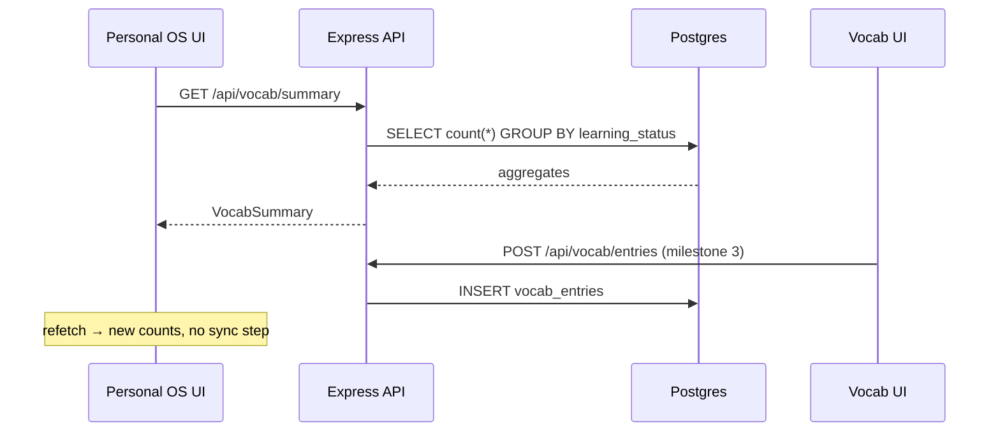

# Architecture

## Repository layout

```
os/
├── apps/
│   ├── api/                One Express backend (all domains, clear module boundaries)
│   │   ├── drizzle/            generated SQL migrations
│   │   ├── scripts/            db-up (setup), db-migrate
│   │   └── src/
│   │       ├── db/schema.ts    THE schema — ownership documented inline
│   │       ├── db/client.ts    shared pg pool (never crashes on DB loss)
│   │       ├── errors.ts       ApiError + central error middleware
│   │       ├── routes/         tasks · events · summaries (integration contract)
│   │       └── server.ts       route mounting + health check
│   ├── personal-os/        Frontend: dashboard shell (React + Vite + Tailwind v4)
│   ├── vocab/              Frontend: library view (typography-led)
│   └── media-tracker/      Frontend: library view (poster-led, dark canvas)
├── packages/
│   ├── shared-types/       Contract types only — no DB row types (see below)
│   ├── ui-theme/           Editorial Systems Design tokens + component classes
│   └── config/             tsconfig.base.json
└── docs/                   This site + design references
```

## Application boundaries (§4, §3.3)

- **One backend, module boundaries.** ADR-002: no microservices, no event bus.
  Each domain owns its route module, its schema tables, and its services.
  Personal OS reaches Vocab/Media **only** through documented HTTP endpoints —
  never by importing another domain's query code.
- **One database, ownership by table prefix.** `tasks`/`events` belong to
  Personal OS; `vocab_*` to Vocab; `media_*` to Media Tracker. No cross-writes.

## Data ownership (§4.2)

| Owner | Tables | Never |
|---|---|---|
| Personal OS | `tasks`, `events` | copies of vocab/media rows |
| Vocab | `vocab_entries`, `vocab_meanings`, `vocab_reviews` | tasks, media |
| Media Tracker | `media_items`, `media_activity` | vocab, tasks |

Personal OS reads summaries **computed at request time** (`routes/summaries.ts`),
so there is no mirror to drift out of sync.

## API design

Versionless-in-dev REST under `/api`, JSON everywhere, zod validation at the
boundary, errors as `{ error: { code, message, details? } }`.

### Integration contract (§4.3) — stable

| Endpoint | Returns | Consumer |
|---|---|---|
| `GET /api/vocab/summary` | `VocabSummary` | OS dashboard |
| `GET /api/vocab/recent` | last 10 entries | OS + Vocab |
| `GET /api/media/summary` | `MediaSummary` | OS + Media |
| `GET /api/media/recent` | last 10 items | OS |
| `GET /api/media/in-progress` | in-progress items | OS |

Types live in `packages/shared-types/src/index.ts`.

### Personal OS domain

`GET/POST /api/tasks`, `PATCH/DELETE /api/tasks/:id`, `GET /api/tasks/today`,
`GET /api/events/upcoming`, `POST /api/events`, `DELETE /api/events/:id`,
`GET /api/health`.

## Database design

Schema: `apps/api/src/db/schema.ts` (Drizzle ORM, PostgreSQL).

- UUID PKs everywhere → stable cross-app identifiers (§3.3 rule 2).
- `jsonb` for open-ended personal input (tags, genres); typed columns for
  anything filtered/sorted.
- `media_items` carries **per-category progress columns** (`current_episode`,
  `current_chapter`, `current_volume`, `current_page`), validated per category
  in the service layer — different media types keep different progress units
  without a polymorphic mess (§7.6).
- `unique(external_source, external_key)` prevents duplicate library records
  from re-searching the same provider record (§7.4).
- `media_activity` is append-only — the history/statistics trail (§7.9).

```mermaid
erDiagram
    tasks ||--o{ "" : "os"
    events ||--o{ "" : "os"
    vocab_entries ||--o{ vocab_meanings : has
    vocab_entries ||--o{ vocab_reviews : has
    media_items ||--o{ media_activity : emits
```

## How data moves between applications



## Important architectural decisions

See [adr/](adr/) — ADR-001 (stack), ADR-002 (monolith with boundaries),
ADR-003 (providers), ADR-004 (design system).

## Security summary (§11)

- Server-side zod validation on every mutating route.
- Parameterized queries only (Drizzle — no string interpolation of input).
- Secrets in `.env` (git-ignored), `.env.example` committed without values.
- CORS open in dev (localhost frontends); tighten at deploy time.
- Error middleware never leaks internals; DB outages → honest `503 db_unavailable`.
- No auth for V1: local single-user deployment (documented assumption).
